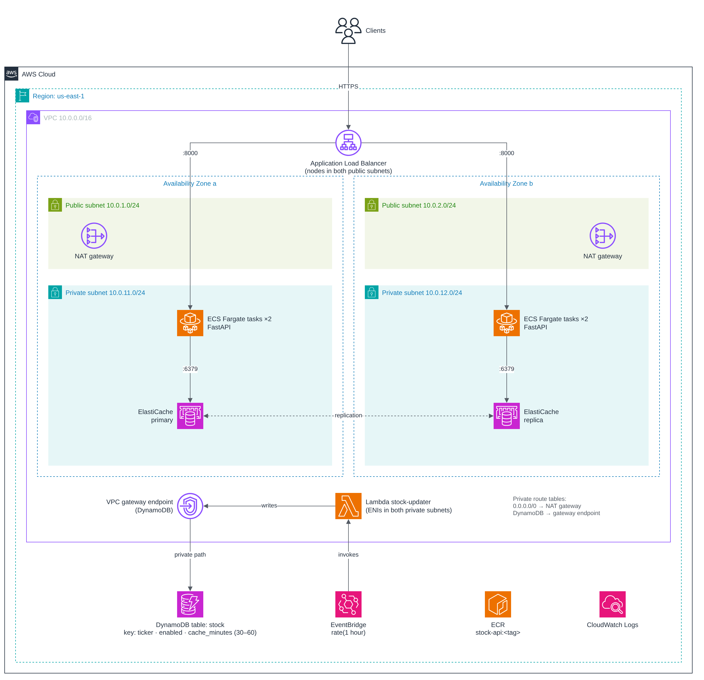

# Stock Price API on Floci

**How close can a free local AWS emulator ([Floci](https://github.com/floci-io/floci)) get to a production AWS architecture, and where does it fall short?** The stock API is just a realistic workload.



1. Draw the production design (diagram **A** in [docs/architecture.md](docs/architecture.md)).
2. Build it on Floci with Terraform. What Floci runs is diagram **B**.
3. Test the difference:

| Level | Command | Result today |
|---|---|---|
| Build | `scripts/deploy.sh` | 47 resources created |
| Match / delta | `scripts/delta.sh` | 30 of 30 match |
| Behaviour | `scripts/e2e.sh` | 22 of 22 pass |

`scripts/pipeline.sh` runs it all from a clean slate and writes a report to `reports/<timestamp>/`.

## What we learned about Floci

| Works | Needed a workaround | Not really exercised |
|---|---|---|
| VPC, subnets, IGW, NAT, routes, security groups | One ECS service per AZ (Floci puts a service's tasks in one subnet) | NAT, IGW, DynamoDB endpoint carry no traffic |
| ALB, ECS tasks as containers, ECR registry | ElastiCache reported as `localhost` → `redis_host_override = "floci"` | Lambda `vpc_config` stored only |
| ElastiCache primary + replica (Valkey) | DynamoDB via `aws_endpoint_override` | Real multi-AZ failover |
| Lambda + hourly EventBridge, DynamoDB, CloudWatch logs | ALB at `localhost:8080` with a `Host` header | IAM / security group enforcement |

`terraform plan` on a deployed stack shows 3 harmless security group diffs (ids read back with an account prefix). Full match/delta tables: [docs/architecture.md](docs/architecture.md).

## The application

```text
 client -> ALB -> FastAPI (ECS) -> 1) DynamoDB: ticker enabled?   no  -> 404 unknown / 403 disabled
                                   2) Redis: price cached?        yes -> return it
                                   3) fetch, cache for cache_minutes, return

 EventBridge (hourly) -> Lambda -> DynamoDB (enabled tickers) -> Redis
```

## Run it

Requires only **Docker**; Terraform, Python and tests run in containers.

```bash
scripts/deploy.sh     # start Floci, Terraform, push image, smoke test
scripts/delta.sh      # match against the production diagram
scripts/e2e.sh        # end-to-end tests
scripts/destroy.sh    # tear everything down (incl. Docker volumes)
```

Try it by hand with `scripts/try.sh demo`, or follow [docs/manual-testing.md](docs/manual-testing.md). Quick check:

```bash
SIG="Authorization: AWS4-HMAC-SHA256 Credential=test/20260101/us-east-1"
ALB=$(curl -s "localhost:4566/?Action=DescribeLoadBalancers&Version=2015-12-01" -H "$SIG/elasticloadbalancing/aws4_request" | grep -o "<DNSName>[^<]*" | head -1 | cut -d'>' -f2)
curl -i -H "Host: $ALB" localhost:8080/stocks/AAPL
```

Floci console: <http://localhost:4566/_floci/ui>

## Layout

| Path | Contents |
|---|---|
| `api/` | FastAPI service (image pushed to ECR) |
| `updater/` | Hourly Lambda |
| `terraform/` | Infrastructure, one file per component |
| `scripts/` | deploy, destroy, tf, test, verify, delta, e2e, pipeline, try, clean-reports |
| `tests/` | e2e tests and the delta checker |
| `docs/architecture.md` | Diagrams A and B, match and delta tables |
| `docs/manual-testing.md` | Step-by-step curl commands to test by hand |

Claude Code commands: `/deploy`, `/destroy`, `/pipeline`, `/clean-reports`.

## Going to real AWS

Remove the `endpoints` block and test credentials from [terraform/providers.tf](terraform/providers.tf), set `redis_host_override=""` and `aws_endpoint_override=""`, and use remote state (S3 + locking).
