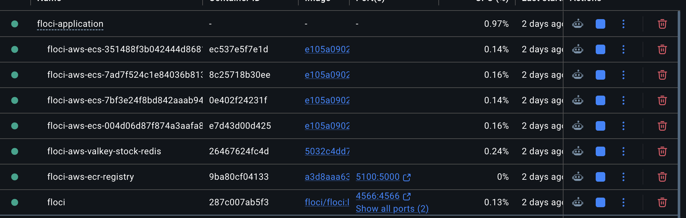
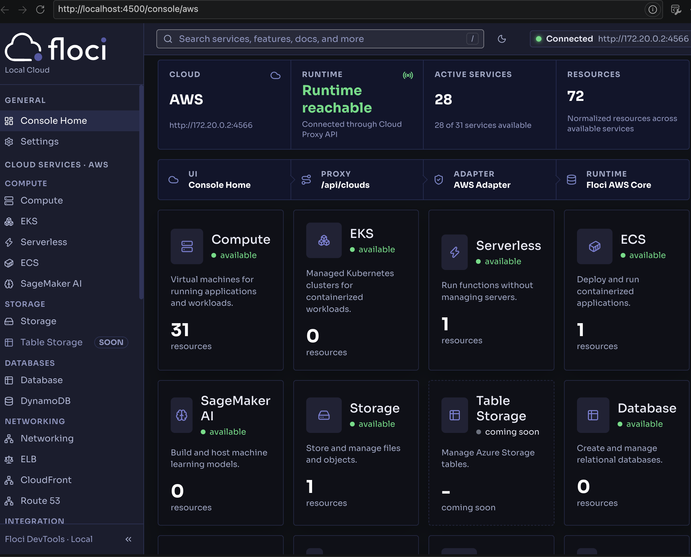

# Floci at runtime

What diagram **B** in [architecture.md](architecture.md) looks like on your machine: the Docker containers Floci starts, and its web console.

## Docker containers

Floci runs each AWS service as a plain Docker container, grouped under the Compose project `floci-application`:

| Container | Stands in for |
|---|---|
| `floci` (port 4566) | The emulator itself, acting as the AWS API. Terraform and the scripts send all their calls here |
| `floci-aws-ui` (port 4500) | The Floci web console (see below). Floci starts it the first time you open the console, so it is missing from the screenshot above |
| `floci-aws-ecr-registry` (port 5100) | ECR, the image registry holding the API image |
| `floci-aws-valkey-stock-redis` | ElastiCache (Valkey), where prices are cached |
| `floci-aws-ecs-<task-id>-api` (x4) | ECS Fargate tasks running FastAPI: 2 for `stock-api-a` + 2 for `stock-api-b` |

The Lambda `stock-updater` has no container in this view, because Floci starts one only while the function is being invoked.

## Web console

Floci has a browser console, like a small AWS Management Console, for looking at what Terraform created.

1. Open <http://localhost:4566/_floci/ui>. This is a "starting" page: Floci launches the `floci-aws-ui` container.
2. You are then sent to the console at <http://localhost:4500/console/aws>. Once the container is running, you can open that link directly.

The home page shows that the runtime is reachable, how many services are available, and a resource count for each service group. The left menu goes to each service (ECS, Serverless for Lambda, DynamoDB, ELB, Networking and more), where you can browse the resources from `terraform/*.tf`.

The console reads the same Floci API that `scripts/delta.sh` checks, so use it to look around, not as proof. The match/delta tables in [match-delta.md](match-delta.md) are the verified record.
